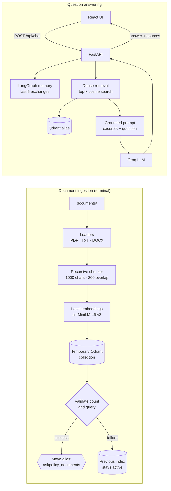

# AskPolicy

AskPolicy is a local-first Retrieval-Augmented Generation (RAG) application for
asking questions about company policy documents. It combines a React chat
interface with a FastAPI backend, local sentence-transformer embeddings, Qdrant
Cloud vector search, and Groq-hosted LLM answers.

Answers are grounded in indexed PDF, TXT, and DOCX files. Every assistant
response cites the document chunks that were actually retrieved, and questions
that the documents cannot answer receive an explicit not-found response instead
of a guess.

## Problem statement

Company policies are spread across handbooks, HR PDFs, Word documents, and
plain-text notices. Keyword search struggles with natural-language questions,
and general-purpose chatbots tend to invent plausible-sounding rules, dates, and
amounts. AskPolicy retrieves the relevant passages first, passes only those
passages to the language model, and returns transparent source references so an
employee can verify the answer.

## Features

- **Grounded answers** — the LLM receives retrieved excerpts and is instructed
  to answer only from them.
- **Source citations** — document name, page number (for PDFs), chunk index, and
  the supporting excerpt are returned with every answer.
- **Local embeddings** — `sentence-transformers/all-MiniLM-L6-v2` runs on CPU;
  no external embedding API is used.
- **Qdrant Cloud vector search** — 384-dimensional cosine similarity search with
  server-side metadata filtering by source document.
- **Safe re-indexing** — each ingestion run builds a temporary collection,
  validates it, then atomically moves the `askpolicy_documents` alias. A failed
  run leaves the previous searchable index untouched.
- **Conversation memory** — LangGraph `MessagesState` plus an in-memory
  checkpointer keeps the last five question/answer exchanges per thread. No
  database and no persistent chat storage.
- **Document-scoped questions** — filter retrieval to a single indexed file from
  the sidebar.
- **Professional UI** — responsive two-pane layout, Markdown answers, loading
  and error states, copy and clear actions, and a session-scoped transcript.
- **Tested core** — 47 backend tests cover loaders, chunking, retrieval,
  ingestion replacement safety, API contracts, and conversation memory.

## Technology stack

| Layer | Technology |
| --- | --- |
| Frontend | React 19, TypeScript, Vite, Tailwind CSS 4, Lucide React |
| Markdown | react-markdown, remark-gfm |
| Backend | Python 3.14, FastAPI, Uvicorn, Pydantic / Pydantic Settings |
| RAG | LangChain, LangGraph (conversation memory only) |
| Embeddings | Sentence Transformers, `all-MiniLM-L6-v2`, CPU |
| Vector database | Qdrant Cloud, official Python client, LangChain Qdrant |
| LLM | Groq API, configurable chat model |
| Documents | PyPDF, python-docx, RecursiveCharacterTextSplitter |
| Tooling | uv, npm, Pytest, Ruff, oxlint |

Exact resolved dependency versions are recorded in `backend/uv.lock` and
`frontend/package-lock.json`.

## Architecture



At query time the backend resolves the alias on every search, so re-indexing
does not require a backend restart.

## RAG workflow

### Ingestion

1. Recursively discover supported files under `documents/`, skipping hidden
   paths and unsupported extensions.
2. Extract text: one unit per PDF page, one unit per TXT file, and one unit per
   DOCX file including table rows. Page numbers are only recorded for PDFs.
3. Split each unit with `RecursiveCharacterTextSplitter` using the separator
   hierarchy `["\n\n", "\n", " ", ""]`, `chunk_size=1000`, and
   `chunk_overlap=200`.
4. Generate normalized 384-dimensional embeddings locally on CPU.
5. Create a uniquely named temporary collection with cosine distance.
6. Upload payloads containing `page_content` and `metadata`
   (`source`, `file_name`, `file_type`, `chunk_index`, and `page_number` when
   available).
7. Validate the point count and run a probe query.
8. Atomically move the configured alias to the new collection.
9. Delete the previous physical collection and any orphaned temporary
   collections created by earlier failed runs.

If no valid documents are found, or any step fails before the alias switch, the
existing index remains searchable.

### Question answering

1. The browser sends the question, optional thread id, optional source filter,
   and recent session history.
2. FastAPI loads the thread from the in-memory LangGraph checkpointer.
3. The question is embedded with the same model used during ingestion.
4. Qdrant returns the top-k nearest chunks, optionally restricted to one source.
5. If no chunks are returned, the backend returns the exact not-found message
   without calling the LLM.
6. Otherwise the prompt combines recent conversation context with numbered,
   clearly delimited document excerpts. History is labelled as unverified
   context, not policy evidence.
7. Groq generates an answer that cites excerpt numbers such as `[1]`.
8. The response contains the answer, the retrieved sources cited by the answer,
   and the thread id. The new exchange is appended to memory, and older
   exchanges are trimmed so at most five remain.

## Project structure

```text
AskPolicy/
├── .env.example
├── .gitignore
├── README.md
├── documents/                 # Put policy files here (ignored by git)
├── docs/
│   ├── ARCHITECTURE.md
│   └── INTERVIEW_GUIDE.md
├── backend/
│   ├── pyproject.toml
│   ├── uv.lock
│   ├── .python-version
│   ├── app/
│   │   ├── main.py
│   │   ├── api/routes/        # health, documents, chat
│   │   ├── core/              # config, errors, logging, prompts, model cache
│   │   ├── schemas/           # Pydantic request/response models
│   │   └── services/          # embedding, Qdrant, retrieval, LLM, RAG
│   ├── ingestion/             # loaders, chunker, metadata, CLI
│   └── tests/                 # pytest suite
└── frontend/
    ├── package.json
    ├── package-lock.json
    └── src/
        ├── components/
        ├── hooks/             # useChat, useWorkspace
        ├── services/api.ts
        ├── types/
        └── utils/
```

## Prerequisites

- Windows, macOS, or Linux with PowerShell examples below
- [uv](https://docs.astral.sh/uv/) for Python environments and dependencies
- Node.js 20+ and npm
- A Qdrant Cloud cluster with its URL and API key
- A Groq API key and access to a supported chat model
- Internet access the first time the embedding model is downloaded

## Environment setup

1. Copy `.env.example` to `.env` in the repository root.
2. Fill in the credentials:

```env
GROQ_API_KEY=your_groq_key
GROQ_MODEL="openai/gpt-oss-120b"

QDRANT_URL=https://your-cluster.cloud.qdrant.io:6333
QDRANT_API_KEY=your_qdrant_key
QDRANT_COLLECTION=askpolicy_documents
```

The remaining defaults are suitable for local development. `GROQ_MODEL` is
configurable, so another currently supported Groq chat model can be used without
changing code.

Backend settings are read from the root `.env` (and optionally
`backend/.env`). Credentials are never exposed to the frontend.

Model weights are downloaded to `backend/.cache/huggingface/`, which is ignored
by git. They are not stored in the global user cache.

## Installation

```powershell
cd backend
uv sync --dev
```

```powershell
cd ../frontend
npm install
```

`uv sync` creates `backend/.venv` and installs the locked Python dependencies.
The frontend installs into `frontend/node_modules`.

## Document ingestion

Place supported files under `documents/`, including nested folders:

```text
documents/
├── employee_handbook.pdf
├── hr/leave_policy.docx
└── notices/travel_policy.txt
```

Then run:

```powershell
cd backend
uv run python -m ingestion.ingest
```

The command prints real statistics collected during the run, including
discovered/processed/skipped files, PDF pages, chunk count, embedding model, and
whether a previous collection was replaced.

Re-run the same command whenever the contents of `documents/` change. The
backend does not need to restart; the next query resolves the updated alias.

Only `.pdf`, `.txt`, and `.docx` are supported. Hidden files, unsupported
extensions, and files with no extractable text are skipped.

## Running the application

Use two terminals after ingestion.

**Backend**

```powershell
cd backend
uv run uvicorn app.main:app --reload --host 127.0.0.1 --port 8000
```

Interactive API documentation is available at
`http://127.0.0.1:8000/docs`.

**Frontend**

```powershell
cd frontend
npm run dev
```

Open `http://localhost:5173`. To use another API URL, set
`VITE_API_BASE_URL` in `frontend/.env.local`.

## API endpoints

| Method | Path | Purpose |
| --- | --- | --- |
| `GET` | `/api/health` | API version, embedding/LLM model names, Qdrant connectivity, collection readiness |
| `GET` | `/api/documents` | Indexed files with file type and chunk count, aggregated from Qdrant payloads |
| `POST` | `/api/chat` | Grounded answer with source references and a conversation thread id |
| `POST` | `/api/chat/reset` | Clear the in-memory LangGraph state for a thread |

### `POST /api/chat`

```json
{
  "question": "What is the annual leave policy?",
  "history": [],
  "source": "hr/leave_policy.pdf",
  "thread_id": null
}
```

`history` is optional and only seeds a new or restarted server thread. The
server-side checkpointer is authoritative after the first turn. `source` is an
optional relative path used for Qdrant metadata filtering. Omit `thread_id` to
start a new conversation.

```json
{
  "answer": "Employees receive 20 days of annual leave per year [1].",
  "sources": [
    {
      "file_name": "leave_policy.pdf",
      "source": "hr/leave_policy.pdf",
      "file_type": "pdf",
      "page_number": 2,
      "chunk_index": 4,
      "content": "Full-time employees receive 20 days of annual leave...",
      "score": 0.81
    }
  ],
  "thread_id": "b7c2...e91"
}
```

The `score` is a cosine similarity value included for transparency; the UI does
not present it as a confidence percentage.

If the index has no relevant chunks, or the model determines the excerpts are
insufficient, the answer is:

```text
I couldn't find this information in the available company documents.
```

and no sources are returned. When an answer cites specific excerpts, only those
cited sources are returned; if the model omits citation markers, all retrieved
chunks are returned as a fallback.

### Error behavior

| Status | Meaning |
| --- | --- |
| `422` | Request validation failed (for example, a blank question) |
| `502` | Groq call failed or returned no text |
| `503` | Qdrant is unconfigured, unreachable, or has no active collection |
| `500` | Unexpected server error; internal details are logged, not returned |

## Testing and quality checks

```powershell
cd backend
uv run pytest
uv run ruff check .
uv run ruff format --check .
```

```powershell
cd frontend
npm run lint
npm run build
```

Tests do not require live credentials: external services are replaced with
fakes, and ingestion tests use an in-memory Qdrant client through the real
Qdrant API surface.

## Documentation

Additional technical and operational details are available in:

- [`docs/ARCHITECTURE.md`](docs/ARCHITECTURE.md) — system design, ingestion/retrieval flow, and key implementation decisions
- [`docs/INTERVIEW_GUIDE.md`](docs/INTERVIEW_GUIDE.md) — component-by-component explanation of the RAG pipeline
- [`docs/RUNNING_AND_DATA.md`](docs/RUNNING_AND_DATA.md) — runbook for setup, ingestion, and data management in Qdrant
